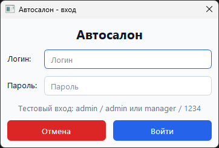
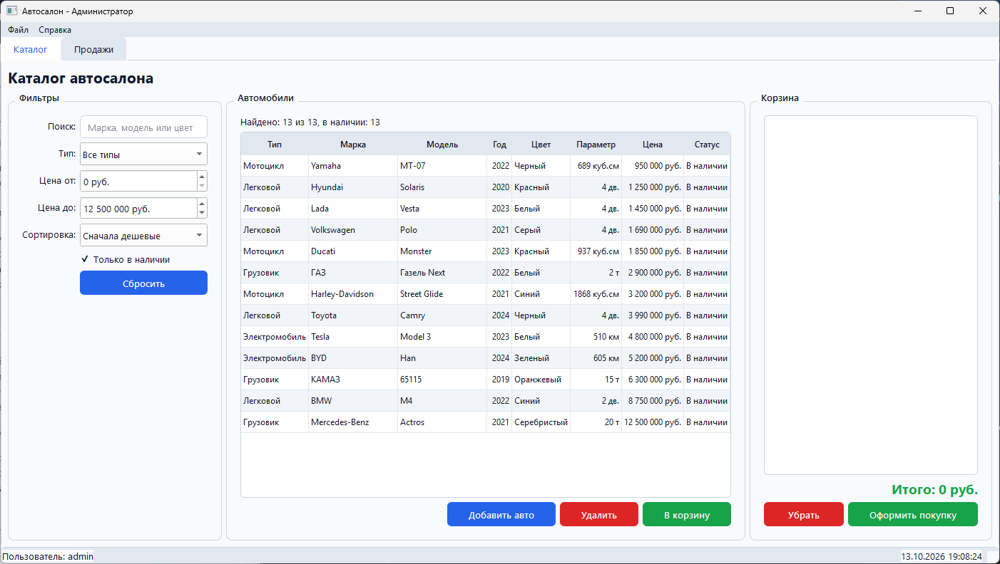
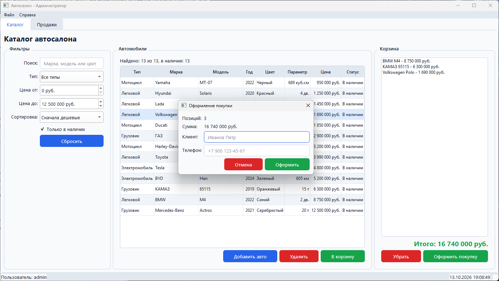

# Автосалон

задание по ооп, python + pyqt6

запуск:
```
pip install -r requirements.txt
python main.py
```

exe можно скачать в Actions (Autosalon-windows) или собрать через build.bat

вход: admin / admin

отчет пишется в report.txt при закрытии

# скрины





